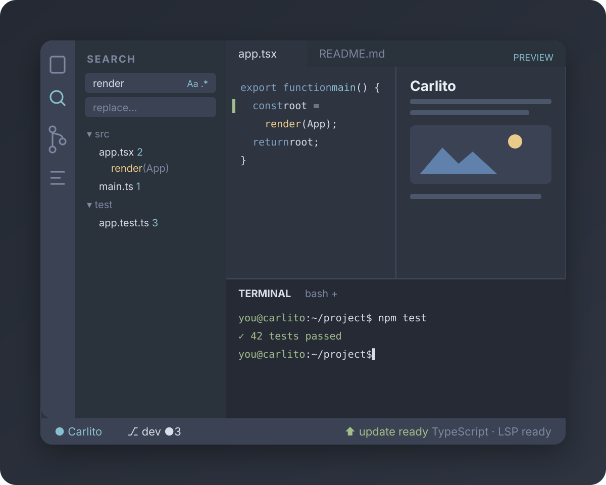

# Carlito

> Everything you need, nothing in the way. A focused, simple workspace for writing code.



Carlito is a small Electron IDE for people who want the useful part of VS Code without the rest of VS Code.

It is intentionally boring: a file tree, tabs, Monaco, and Language Server Protocol support. No marketplace, no extension platform, no built-in chat, no project system, no telemetry, no side quests. Open a folder, edit files, let your language server do the smart bits.


## Why

VS Code is excellent, but it is also a platform. Carlito is just an editor-shaped IDE:

- faster to start
- smaller in scope
- fewer moving parts
- no bells and whistles
- LSP-first instead of extension-first

If a feature does not help you open code, edit code, navigate code, or get LSP feedback, it probably does not belong here.

## Features

- Workspace file tree
- Monaco editor
- Tabs and editor splits, with draggable tabs
- Quick open (`Ctrl+P`)
- Command palette (`Ctrl+Shift+P`)
- Save / Save As
- Soft wrap enabled by default, with a command palette toggle
- Go back / go forward navigation
- Basic color theme selection
- Git gutter baseline for changed lines
- LSP integration over stdio, with organize imports on save
- Configurable language-to-server mapping
- Optional `carlito` shell command for opening folders from a terminal
- Search in the sidebar: find and replace across the workspace, with case / whole word / regex options, include / exclude patterns, and results grouped in a folder tree
- Source Control: see changes as a folder tree, stage, unstage, commit and pull, with the current branch in the status bar
- Integrated terminal tabs (`Ctrl+Shift+T`) in a resizable bottom panel, with a right-click menu (copy, paste, select all, clear)
- Markdown: switch in place between source, formatted preview and a rich editor
- Previews for HTML, SVG, PDF and images instead of raw content
- Recent folders on the welcome screen and in the workspace menu
- In-app updates: Carlito installed from the `.deb` checks for new releases and updates itself
- More room for the code: no menu bar and no title bar; commands live in the activity bar, the workspace menu and the command palette

## Install

Download the latest package from the [Releases page](https://github.com/deka/carlo/releases).

### Debian / Ubuntu (recommended)

```sh
sudo apt install ./carlito_<version>_amd64.deb
```

Then start it from the applications menu, or from a terminal:

```sh
carlito            # open the current directory
carlito ~/project  # open a folder
```

The package installs Carlito in `/opt/carlito`, adds the `carlito` command, and installs an AppArmor profile so the Chromium sandbox works on Ubuntu 24.04 and later without root.

### Other Linux distributions

```sh
tar xzf carlito-<version>.tar.gz
./carlito-<version>/carlito
```

On distributions that restrict unprivileged user namespaces (Ubuntu 24.04+), the tarball cannot start sandboxed: use the `.deb` there.

Each release ships a `SHA256SUMS` file:

```sh
sha256sum --check --ignore-missing SHA256SUMS
```

## Build from source

Requirements: Node.js 24, npm, and a C/C++ toolchain for the terminal's native module (`node-pty`): `python3`, `make`, `g++` (on Debian/Ubuntu: `sudo apt install build-essential python3`).

```sh
npm ci
npm run dev       # run in development mode
npm run package   # build dist/carlito_<version>_amd64.deb and dist/carlito-<version>.tar.gz
```

Before sending changes, run `npm run typecheck`, `npm run lint` and `npm run build`.

## Releasing

Releases are built by GitHub Actions ([`.github/workflows/release.yml`](.github/workflows/release.yml)). Every push to `main` typechecks, lints, builds the Linux packages, and publishes them with checksums as a GitHub release.

The version is the `major.minor` from `package.json` plus a patch number one above the previous release tag (`0.1.0`, `0.1.1`, … tagged `v0.1.0`, `v0.1.1`, …). Bump `major.minor` in `package.json` to start a new series. To build packages without publishing, run the workflow manually from the Actions tab (on any branch) and download the artifact.

## Language support

Carlito speaks LSP. Language intelligence comes from language servers installed on your machine or bundled with the app.

### Configure languages

Carlito creates a language configuration file at:

```text
~/.config/carlito/languages.json
```

Open it from the command palette with:

```text
Preferences: Open Language Config
```

Example:

```json
{
  "languageServers": {
    "python": { "command": "pyright-langserver", "args": ["--stdio"] },
    "plaintext": null
  },
  "extensions": {
    ".py": "python",
    ".txt": "plaintext"
  }
}
```

Use `null` for languages that should not start a server.

## Keyboard shortcuts

| Shortcut (Linux/Windows) | Shortcut (macOS) | Action |
| --- | --- | --- |
| `Ctrl+Shift+P` | `Cmd+Shift+P` | Command palette |
| `Ctrl+P` | `Cmd+P` | Quick open file |
| `Ctrl+O` | `Cmd+O` | Open file |
| `Ctrl+S` | `Cmd+S` | Save |
| `Ctrl+Shift+S` | `Cmd+Shift+S` | Save as |
| `Ctrl+W` | `Cmd+W` | Close tab |
| `Ctrl+Shift+T` | `Cmd+Shift+T` | New terminal |
| `Ctrl+Space` | `Cmd+Space` | Trigger suggestions |
| `Ctrl+[` | `Cmd+[` | Go back |
| `Ctrl+]` | `Cmd+]` | Go forward |
| `Ctrl+Alt+Right` | `Cmd+Option+Right` | Split editor right |
| `Ctrl+Alt+Down` | `Cmd+Option+Down` | Split editor down |
| `Ctrl+=` | `Cmd+=` | Zoom in |
| `Ctrl+-` | `Cmd+-` | Zoom out |
| `Ctrl+0` | `Cmd+0` | Reset zoom |

In a terminal, keys go to the shell (`Ctrl+C`, `Ctrl+W`, `Ctrl+P`…); only `Ctrl+Shift` / `Ctrl+Alt` shortcuts reach Carlito. Copy and paste with `Ctrl+Shift+C` / `Ctrl+Shift+V`.

## Philosophy

Carlito is not trying to become your operating system. It is an IDE with LSP. That's it.

## Thanks

Thanks to [@rumpl](https://github.com/rumpl) for creating [Carlo](https://github.com/rumpl/carlo), which made Carlito possible.
